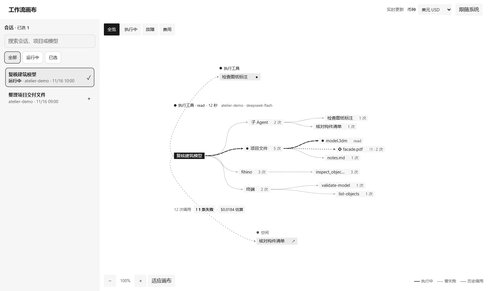

# Agent Workflow Viewer

[简体中文](README.zh-CN.md) · [DeepSeek Harness](https://github.com/deepseek-ai/deepseek-harness)

See what your Harness agent is doing while it works. Open **◇ Workflow** beside the conversation input to inspect active tool calls, find failures, or switch to a subagent's timeline.



## Install

Open the **Plugins** page in DeepSeek Harness and install the published `0.1.0` bundle using this source:

```text
git+https://github.com/hgognav233-netizen/agent-workflow-viewer.git#677a39b6f1f0742c2fbc20b5ef45e63a0e196ffd
```

Enable the bundle, then reload Harness and open a conversation. The published bundle shows the original Chinese interface and launcher. The screenshot and walkthrough below describe the development version of the plugin.

To try the development version, clone this repository and install the checkout as a local bundle. Pass the absolute checkout path to the Plugins page or the plugin manager's `install_bundle` action. Restart the Harness host after changing `index.js` and reload the interface after changing `client.js`.

## Use the viewer

- **Overview** shows tool calls, failures, active calls, token usage, and estimated spend. Follow the moving paths to see which tools are running. Select a dot to open its detail card next to it. Repeated access to the same object appears as one dot; crowded maps grow taller so names stay readable.
- **Running now** lists simultaneous calls. Select a call to open its event in the timeline.
- **Timeline** shows message excerpts, the model's reasoning, call status, duration, and result excerpts. Filter by all, tools, thinking, or failures, and page through retained activity.
- **Spend (estimated)** shows the total and the most expensive steps; select one to open it in the timeline. Prices are the public API list with peak and off-peak rates. Tools that share one request cannot be split further, and this is an estimate rather than a bill.
- **Subagents** lists who dispatched which subagent — using the label given at dispatch — with its call count and estimated spend.
- **Session selector** opens a subagent's own activity when Harness reports it as a descendant of the current conversation.

The graph groups activity into web tools, local processes, files and skills, and external services. It prioritizes active, failed, and recent objects when space is limited. Counts reflect the latest 3,000 events owned by the selected session. The timeline shows up to 400 matching entries per page. The interface uses Simplified Chinese when the page language is Chinese and English otherwise.

Use **Browser board** in DSH Desktop or **Detach** in DSH Web to open the viewer beside your conversation. The board opened from DSH Web is the same page as the panel — overview, timeline with filtering and paging, session selector, object detail cards, and zoom/pan — and adds a colour-scheme button (follow system, light, dark). The DSH Desktop browser board keeps its reduced summary. [Detached windows and split screen](docs/detached-window.md#english)

## Data and access

The plugin reads Harness session logs and serves the map and timeline through the Harness web server. It does not modify logs or send them to another service. Activity responses can contain message excerpts, the model's reasoning text, tool results, local paths, or command summaries. Review screenshots and diagnostics before sharing them. Spend is estimated by the plugin from the public price list; Harness itself records no money.

Activity routes request authenticated Harness access. On older hosts without route admission, a peerless request is allowed only through a loopback listener with a local authority and no cross-site browser context. Keep older hosts local and avoid publishing their viewer routes through a proxy. [Harness Web Server documentation](https://github.com/deepseek-ai/deepseek-harness/blob/master/docs/subsystems/web-server.md)

## Contribute

Run the tests with Node.js 22 or 24. The tests use the built-in runner and synthetic session logs.

```sh
npm test
```

The host projection is in `index.js` and the conversation panel is in `client.js`. To report a problem, open an [issue](https://github.com/hgognav233-netizen/agent-workflow-viewer/issues) with your Harness version, operating system, and the steps needed to reproduce it. Use a synthetic or redacted session when attaching examples.

[Changelog](CHANGELOG.md) · [MIT license](LICENSE)
