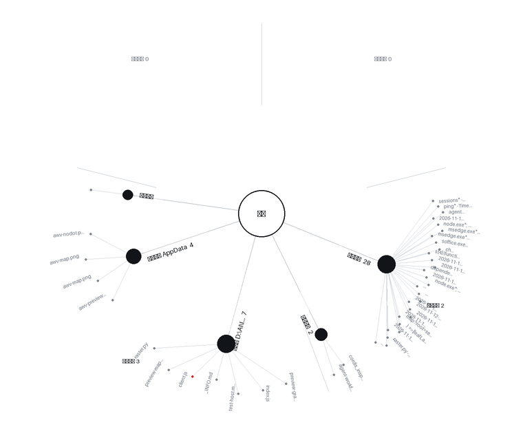

# 工作流视图 · Agent workflow viewer

一个 DeepSeek Harness 插件：把**这个模型正在怎么工作**画成一张可缩放的图——它在调什么、从哪儿拿东西、收到了什么、派发了哪个子 agent。



> 预览图是浏览器外的近似渲染，实际界面是矢量图，可以缩放平移。

## 它画什么

```
        模型（云端 API）            ← 圆心：模型名 + 请求次数 + 入/出 token
   ┌──────────┼──────────┐
 云端检索    本机进程    本机磁盘    外部程序   ← 四个扇区
  联网搜索   工具/子agent  技能包/文件   MCP 服务
```

- **中间一圈大点** = 一类能力（本机终端、项目文件、MCP 服务器、技能包、子 agent、插件系统、历史会话、计划……），大小按它下面有多少个**不同对象**；
- **外圈小点** = 一个具体对象（一个文件、一条命令、一个查询词、一个 MCP 工具），位置按最后碰到的时间排，大小 = 被碰过几次，红色 = 有过失败；
- **同一个东西只算一个点**：同一个文件读十次仍然一个点，点数表示"碰过几个不同的东西"，不是"调了几次"；
- **正在跑的那一次**：从模型到能力、从能力到那个点的两段连线会流动，点外面有脉冲光圈，旁边弹出实时气泡（工具名 · 已跑多久 · 参数概要）；
- 点大点看能力详情，点小点看对象详情（次数、耗时、路径），卡片里可以跳到时间线对应那一条；
- 滚轮缩放、拖动平移、点节点看细节；对象名字按拥挤程度分档显示，放大会全部展开。

按钮在输入框右侧（`◆ 工作流`），面板浮在页面右侧。

## 安装

在 DeepSeek Harness 的 **Plugins** 页面安装，或者让 agent 调用插件管理器的 `install_bundle`。

从 GitHub 安装（把 `<commit>` 换成仓库里任意提交的 40 位 SHA）：

```
git+https://github.com/hgognav233-netizen/agent-workflow-viewer.git#<commit>
```

从本地目录安装：克隆本仓库，然后把 `install_bundle` 的目标指向该目录的绝对路径。

安装后刷新页面，输入框右侧会出现「◆ 工作流」按钮。

## 数据从哪来

Host 半（`index.js`）只**读**会话日志（`session/event`、`sessionQuery`），不改写、不注入任何东西。它把事件折叠成三样东西，通过三个只读 HTTP 路由给前端（只监听 127.0.0.1）：

| 路由 | 内容 |
|---|---|
| `GET /agent-workflow/map?root=<sessionId>` | 能力图：模型信息 + 能力节点 + 对象明细 + 正在跑的调用 |
| `GET /agent-workflow/snapshot?root=<sessionId>` | 时间线：会话树 + 事件流 |
| `GET /agent-workflow/ping` | 存活检查 |

前端（`client.js`）每 1.2 秒轮询一次，不做本地折叠。

## 已知限制

- 轮询而不是推送，气泡里的秒数每 1.2 秒跳一次；
- 每类能力最多保留最近 140 条调用明细，时间线最多显示最近 400 条；
- 改 Host 代码（`index.js`）需要重启 Harness 才生效，改前端（`client.js`）刷新页面即可；
- 三个 HTTP 路由没有鉴权，只绑定 127.0.0.1（本机）；
- 界面文案目前是中文硬编码。

## License

MIT
