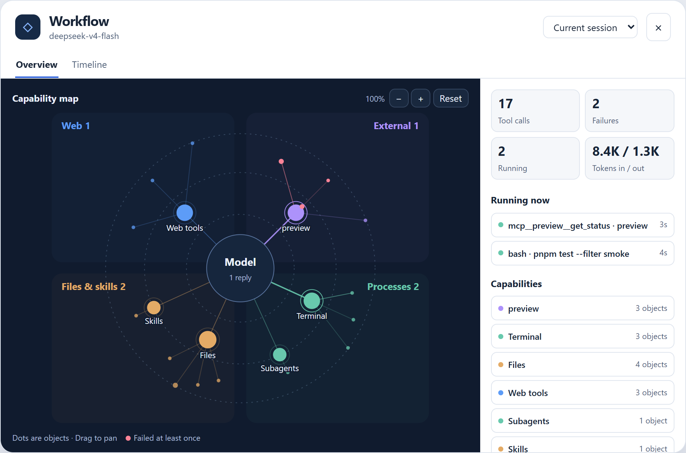

# 工作流视图

[English](README.md) · [DeepSeek Harness](https://github.com/deepseek-ai/deepseek-harness)

在 Harness 执行任务时，查看当前有哪些工具在跑、哪里失败了、子 Agent 做了什么。在对话输入框旁点 **◇ 工作流** 即可打开面板。



## 安装

打开 DeepSeek Harness 的 **Plugins** 页面，使用以下地址安装已发布的 `0.1.0`：

```text
git+https://github.com/hgognav233-netizen/agent-workflow-viewer.git#677a39b6f1f0742c2fbc20b5ef45e63a0e196ffd
```

启用插件，刷新 Harness 后打开一个对话。已发布版本使用初版中文界面。上方截图和以下操作说明对应开发版。

试用开发版时，克隆本仓库，然后在 Plugins 页面或插件管理器的 `install_bundle` 中填写仓库的绝对路径。修改 `index.js` 后重启 Harness 宿主，修改 `client.js` 后刷新界面。

## 怎么用

- **概览**显示工具调用、失败、运行中和 token 用量。沿流动的连线可以看到正在执行的工具，点击小点会在节点旁弹出详情卡。同一个对象被多次访问时仍显示为一个点。
- **正在执行**列出并行运行的调用。点一条即可跳到对应的时间线记录。
- **时间线**显示消息、工具状态、耗时和结果摘要。可筛选失败，也可翻页查看近期记录。
- **会话选择器**用于查看当前对话下的子 Agent，只显示所选会话自身产生的活动。

能力图分为网络、本机进程、本机磁盘和外部服务四区。内容较多时优先显示运行中、失败和近期对象。统计范围是所选会话自己产生的最近 3,000 个事件。时间线每页最多 400 条符合筛选条件的记录。界面根据页面语言选择简体中文或英文。

在 DSH Desktop 点「浏览器看板」，或在 DSH Web 点「独立窗口」，即可把实时摘要放在对话旁边。 [独立窗口与分屏说明](docs/detached-window.md#简体中文)

## 数据和访问范围

插件读取 Harness 的会话日志，通过 Harness Web 服务提供能力图和时间线。插件不会修改日志，也不会把日志发给其他服务。响应可能含有消息片段、工具结果、本地路径或命令摘要，分享截图和诊断信息前请检查内容。

活动路由使用 Harness 的访问鉴权。旧版宿主没有路由鉴权时，插件只允许经本机回环监听地址进入、使用本机请求地址且来自非跨站浏览器上下文的无身份请求。旧版宿主适合在本机使用，请避免通过代理公开这些路由。 [Harness Web Server 文档](https://github.com/deepseek-ai/deepseek-harness/blob/master/docs/subsystems/web-server.md)

## 参与开发

使用 Node.js 22 或 24。测试使用 Node 内置运行器和模拟会话日志。

```sh
npm test
```

`index.js` 负责日志折叠和数据接口，`client.js` 负责对话面板。欢迎提交 [Issue](https://github.com/hgognav233-netizen/agent-workflow-viewer/issues)。请附上 Harness 版本、操作系统和复现步骤，示例会话请使用模拟数据或先脱敏。

[更新记录](CHANGELOG.md) · [MIT 许可证](LICENSE)
