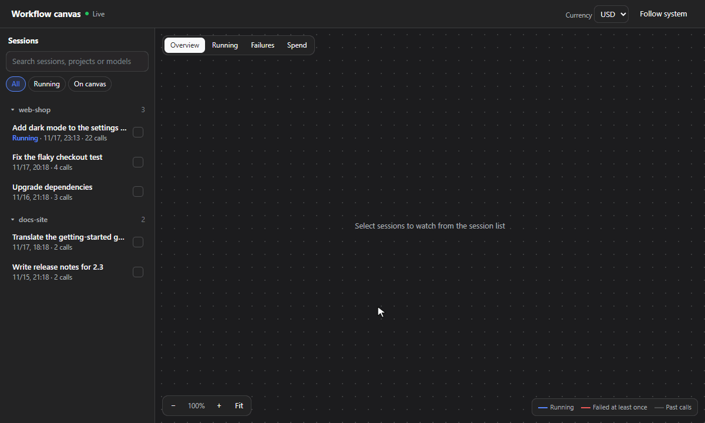

# 工作流视图

[English](README.md) · [DeepSeek Harness](https://github.com/deepseek-ai/deepseek-harness)

在 Harness 执行任务时，查看当前有哪些工具在跑、哪里失败了、子任务做了什么。左侧导航里「插件」下方有一个「工作流」图标，点开是**所有会话的画布**；在对话输入框旁点「◇ 工作流」，打开的是同一个画布，只聚焦当前对话。两处都跟随 Harness 的语言和配色。

## 会话画布（应用级）

左侧的「工作流」图标打开一整页，不绑定当前对话：

- 左栏会话列表和 Harness 侧栏规则一致：按工作区分组，置顶的在前，其余按最近活动排序，标题与侧栏相同；不列子 Agent 会话和空白会话，已归档会话可在列表底部选择显示。
- 可按会话名、项目、模型搜索，也可只看运行中或已在画布上的会话。
- 点击或拖入会话，它的卡片就出现在画布上：表头是完整标题、状态和模型，下面是「模型 → 能力 → 对象」图。拖动卡片表头移动，拖动空白处平移，滚轮缩放，「适应」找回所有卡片。
- 执行中的连线用 Harness 的强调色，失败的用红色。可切换全览、执行中、故障、费用四种显示。
- 子任务自动出现在父会话周围，点开可在同一画布上展开它的工作流。
- 点会话、能力或对象打开右侧详情栏：「概览」页有总数、正在执行、近期失败、费用最高的模型请求和子任务；「时间线」页是这个会话的完整记录。
- 选择、卡片位置、收起的工作区、是否显示已归档，都保存在浏览器里。

登录 DSH Web 后可直接打开 `/agent-workflow/canvas`。在 DSH Desktop 点「在浏览器打开」，会生成一个两小时有效的链接，在系统浏览器里看到的信息和 Harness 里的画布一样。顶部可切换美元和人民币，人民币金额按界面标注日期的参考汇率估算。



## 安装

在 DSH Web 的 `web` profile 中从 GitHub 安装 `0.4.0`：

```sh
dsh plugin --profile web add github:hgognav233-netizen/agent-workflow-viewer#v0.4.0
```

在 DSH Desktop 打开「插件」，填入 Git 源地址：

```text
git+https://github.com/hgognav233-netizen/agent-workflow-viewer.git#v0.4.0
```

启用插件，重启 Harness，然后从左栏打开「工作流」。

试用开发版时，克隆本仓库，然后在 Plugins 页面或插件管理器的 `install_bundle` 中填写仓库的绝对路径。修改 `index.js` 后重启 Harness 宿主，修改 `client.js` 后刷新界面。

## 怎么用

- **概览**（详情栏）显示工具调用、失败、执行中和估算费用，以及正在执行、近期失败、费用最高的模型请求和子任务列表。点任何一条都会跳到时间线里对应的记录。
- **时间线**显示消息、思考过程、工具调用的状态和结果、每轮的开始与结束。可筛选全部 / 工具 / 思考 / 失败，可翻到更早的记录，也可回到最新。
- **费用（估算）**按官方 API 公开价目给每次模型请求估价，区分峰时与谷时；一次请求里同时跑多个工具时无法再细分到单个工具，这是估算，不是账单。
- `subagent`、`wait_agent` 这类协调调用显示为动作名（「派生子任务」「等待子任务」），子任务本身画成分支。MCP 工具按「MCP · 服务名」分组。

统计范围是每个会话自己产生的最近 3,000 个事件。时间线每页最多 400 条符合筛选条件的记录。在 Harness 里，画布使用 Harness 的语言设置，改设置后立即跟着变；浏览器链接沿用打开时的语言；其他情况按浏览器语言。

原来的单会话页面 `/agent-workflow/view?root=…` 现在会打开聚焦这个会话的画布。

## 数据和访问范围

插件读取 Harness 的会话日志，通过 Harness Web 服务提供画布和时间线。插件不会修改日志，也不会把日志发给其他服务。响应可能含有消息片段、模型的思考内容、工具结果、本地路径或命令摘要，分享截图和诊断信息前请检查内容。花费是插件按公开价目自行估算的，Harness 本身不记录金额。

活动路由使用 Harness 的访问鉴权。DSH Desktop 生成的浏览器链接只在本机回环地址可用，两小时后失效，密钥放在地址的 `#` 后面，浏览器不会把这部分发给服务器或写进来源信息。拿到链接的人在这台电脑上能看到和画布一样的记录，请不要转发。旧版宿主没有路由鉴权时，插件只允许经本机回环监听地址进入、使用本机请求地址且来自非跨站浏览器上下文的无身份请求。 [Harness Web Server 文档](https://github.com/deepseek-ai/deepseek-harness/blob/master/docs/subsystems/web-server.md)

## 参与开发

使用 Node.js 22 或 24。测试使用 Node 内置运行器和模拟会话日志。

```sh
npm test
```

`index.js` 负责日志折叠和数据接口，`canvas.js` 是画布页面，`client.js` 把它放进 Harness 界面。欢迎提交 [Issue](https://github.com/hgognav233-netizen/agent-workflow-viewer/issues)。请附上 Harness 版本、操作系统和复现步骤，示例会话请使用模拟数据或先脱敏。

[更新记录](CHANGELOG.md) · [MIT 许可证](LICENSE)
